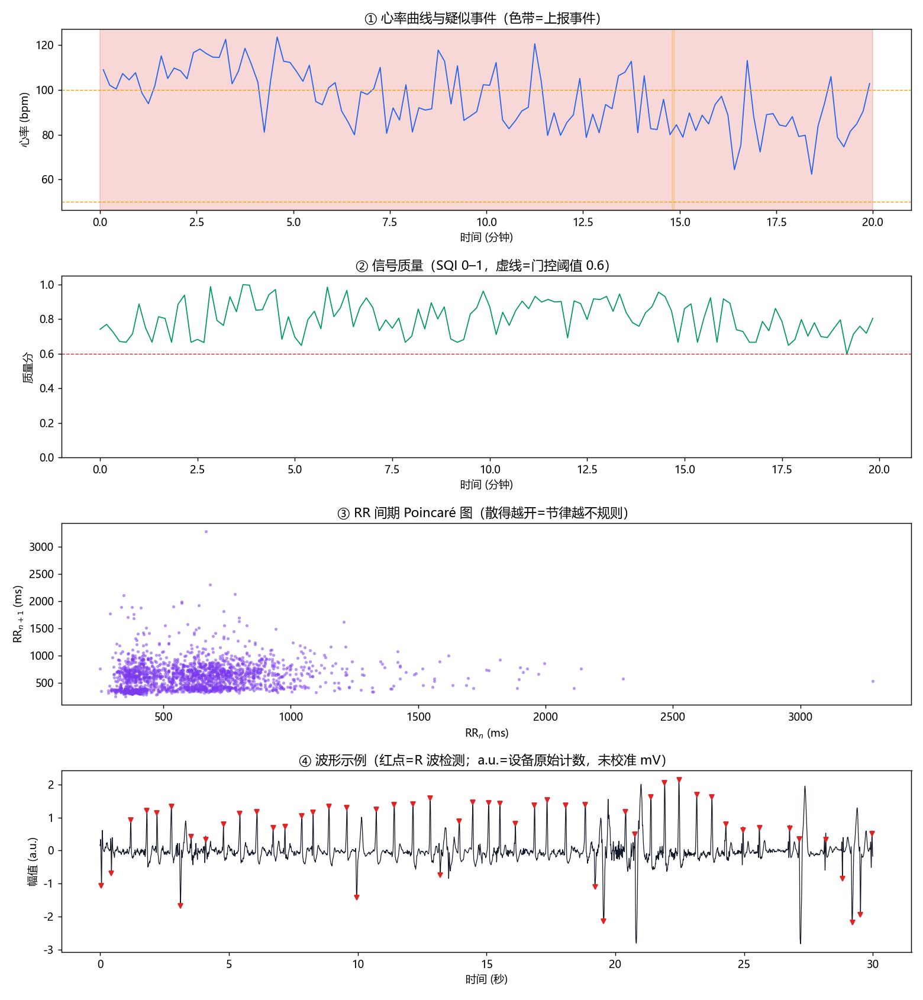

# 心电分析报告（提示级）

- 数据来源：`mitdb:203`
- 记录时长：20.1 分钟（分析采样率 250 Hz）
- 有效监测时长占比：99.2%（通过质量门控的窗口比例）
- 生成时间：2026-10-17 09:49
- 生成工具：ecg_agent 心电分析智能体（规则策略版，非诊断用途）

## 一、结论（提示级）

本次记录检出 **2** 处**建议尽快就医复核**的疑似心律变化（见下表）。

> 本结果由算法自动生成，仅作健康提示，**不构成诊断**；如有不适或需要结论，请携带完整记录由医生复核。

## 二、心率概览

- 平均心率：94 bpm
- SDNN：261 ms；RMSSD：353 ms；pNN50：82%
- RR 变异系数：0.410；样本熵：1.71

## 三、疑似事件（经五层策略过滤后上报）

| # | 类型 | 时间 | 分级 | 置信度 | 依据 |
|---|------|------|------|--------|------|
| 1 | 疑似房颤样心律 | 0.0 min | 建议尽快就医复核 | 0.99 | RR 不规则持续 1200 s（窗口评分均值 0.99） |
| 2 | 疑似早搏 | 0.0 min | info | 1.00 | 0.0–19.8 min 区间内共 318 次 |
| 3 | 长间歇/疑似停搏 | 14.8 min | 关注 | 0.73 | RR 间期 3.3 s（≥3 s） |

## 四、被防误报策略压掉的候选（附录）

这些候选曾触发筛查阈值，但被后续层判定为不可报告（这正是'少误报'的来源）：

| # | 类型 | 起始 | 压掉原因 |
|---|------|------|----------|
| 1 | 疑似早搏 | 19.3 min | 质量分 0.60 < 0.6（L1 质量门控压掉） |

## 五、图



## 六、决策日志（白盒记录）

```
[工具:load] 来源 mitdb:203，原始 20.1 分钟 @ 360 Hz
[工具:preprocess] 0.09s
[工具:detect_qrs(pan_tompkins)] 0.49s
[工具:detect_qrs(xqrs, 第二意见)] 1.08s
[工具:detect_qrs] 主检测器 1895 拍，第二检测器 1958 拍
[工具:assess_quality] 0.66s
[工具:assess_quality] 120 个 10 s 窗，合格率 99.2%
[工具:hrv_features] 0.20s
[工具:hrv_features] 平均心率 94 bpm，SDNN 261 ms，RMSSD 353 ms
[工具:hr_series] 0.00s
[工具:apply_layers] 0.57s
[L5 个体定标] 启用：{'median_rr': 0.56, 'hr_baseline': 107.91, 'cv_baseline': 0.31, 'pause_s': 3.0, 'tachy': 132.91, 'brady': 50.0, 'af_cv': 0.77}
[筛查] 原始候选事件 321 个
[L1 质量门控] 321 个候选事件，压掉 1 个（阈 0.6）
[L3 二次确认] 320 个事件，320 个复现，0 个降级
[L2 分级] 事件分级：{'info': 318, 'caution': 1, 'refer': 1}
```

## 七、方法与环境

- 预处理：两级中值滤波去基线 + 0.5–40 Hz 带通 + 50 Hz 陷波
- QRS 检测：自实现 Pan-Tompkins（SPKI/NPKI 双阈值 + 回溯搜索），第二检测器 XQRS 用于事件二次确认
- 质量评估（在仅去直流的原始信号上）：QRS 带比、基线比、工频比、高频比、带通峰度、形态一致性 → 0–1 质量分；另计算 6 子频段能量比/熵（12 维）备查
- 房颤样筛查：RR 域 8 维特征 + 逻辑回归（按记录分组交叉验证训练）
- 五层策略：质量门控 → 分级 → 二次确认 → 人审兜底 → 个体定标
- 已知限制：本报告的臂带/腕带形态未定标；阈值来自公开数据集，部署到自研设备前必须用自己的数据重新标定
